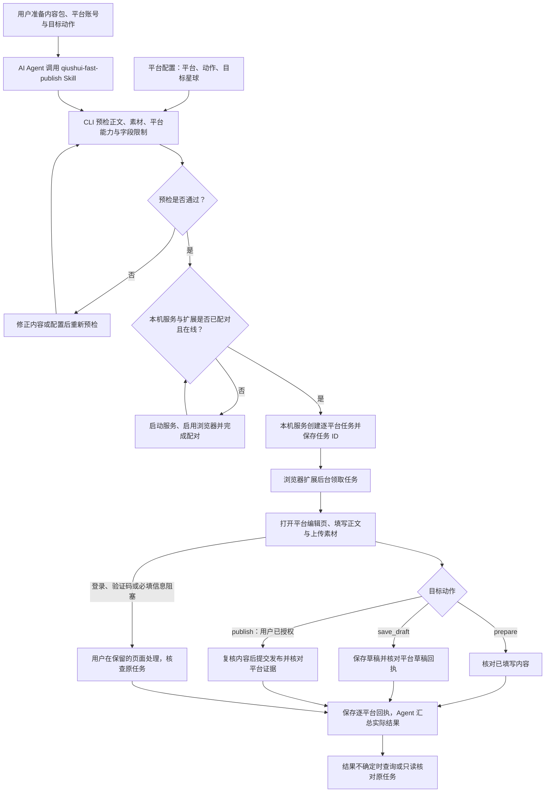

# FastPublish · 秋水快速发布

**一份内容，通过 AI Agent 和浏览器扩展送达多个自媒体平台。**

FastPublish（qiushui-fast-publish）由 Agent Skill、本机任务服务和浏览器扩展组成。你准备内容包、登录平台并确定目标动作；Agent 负责预检和任务追踪，扩展在平台编辑页填写正文、上传素材并返回逐平台回执。

项目包含动态、文章、视频、播客四类适配结构。当前 Skill 默认流程主要用于**动态卡片（图文）和动态纯文字**，各平台可用动作以[平台配置](skills/qiushui-fast-publish/config/platforms.yaml)、预检结果及真实验收记录为准。

## 系统包含哪几部分

| 部分 | 职责 | 位置 |
| --- | --- | --- |
| Agent Skill | 指导 Agent 读取内容包、预检、提交任务、核对结果 | [qiushui-fast-publish](skills/qiushui-fast-publish/SKILL.md) |
| 本机任务服务与 CLI | 配对扩展、管理任务队列、提供素材、保存回执 | [Python 脚本](skills/qiushui-fast-publish/scripts/multipost.py) |
| 浏览器扩展 | 领取任务、打开平台页面、填写和上传、执行目标动作 | `src/background/`、`src/sync/` |
| 平台配置 | 按内容类型选择平台、目标动作及目标星球等信息 | [platforms.yaml](skills/qiushui-fast-publish/config/platforms.yaml) |
| 测试代码与素材 | 验证预检和任务协议，提供按内容类型分类的测试内容包 | [tests](tests/README.md) |

用户的内容包是独立目录，包含 `content.yaml` 或 `content.json`，以及正文、图片、视频等材料。内容包和测试素材均不属于 Skill 安装包。

## 执行流程概览



扩展后台约每 30 秒领取任务，各平台有独立任务 ID 和结果。Agent 通过本机 CLI/API 工作，日常执行无需 Agent 的浏览器或电脑控制权限。

动态图文和纯文字的详细流程见 [diagrams](diagrams/README.md)。

## 用户需要准备什么

- **同一台电脑上的浏览器和扩展**：使用已加载 FastPublish 的 Chrome，执行时保持浏览器和扩展启用。
- **Python 3 与依赖**：保留现有 Python 实现；YAML 输入和默认平台配置需要 PyYAML。
- **可持续运行的本机服务**：监听 `127.0.0.1:2663`，首次使用与扩展配对。
- **AI Agent**：能够读取文件、调用命令或 HTTP，并加载 [Skill](skills/qiushui-fast-publish/SKILL.md)。
- **平台账号**：在安装扩展的浏览器中登录目标平台；验证码等交互由用户处理。
- **内容包**：准备正文及所需素材，文件放在同一内容目录内，格式见[内容目录规范](skills/qiushui-fast-publish/references/content.md)。
- **平台和动作选择**：核对平台配置，知识星球需填写自己的目标星球；公开发布前明确授权具体内容及平台。

从源码加载开发扩展还需要 Node.js 和 pnpm。换电脑时重新安装、配对并登录平台；远程 Agent 的 localhost 不等于运行扩展的电脑。

## 安装与首次执行

以下命令均在仓库根目录执行。完整的安装、跨 Agent 移植和 API 说明见[安装与配对](skills/qiushui-fast-publish/references/setup.md)。

### 1. 加载扩展

```bash
pnpm install
pnpm dev --no-cs-reload
```

在 Chrome 的 `chrome://extensions` 中启用开发者模式，选择“加载已解压的扩展程序”，加载 `build/chrome-mv3-dev`。在此浏览器登录目标平台。验收或正式执行前，待编译完成后停止开发热更新，避免编辑页因更新丢失现场。

### 2. 安装 Python 依赖并启动本机服务

```bash
python3 -m venv .venv
source .venv/bin/activate
python3 -m pip install -r skills/qiushui-fast-publish/scripts/requirements.txt
python3 skills/qiushui-fast-publish/scripts/multipost.py serve
```

以上虚拟环境激活命令适用于 macOS/Linux。保持服务终端运行，在另一个终端进入仓库并激活同一环境。

### 3. 完成一次性配对

```bash
source .venv/bin/activate
python3 skills/qiushui-fast-publish/scripts/multipost.py pair
python3 skills/qiushui-fast-publish/scripts/multipost.py connection
```

运行 `pair` 后，在安装扩展的浏览器打开返回的 URL，点击配对按钮，再运行 `connection`。返回 `paired: true` 且 `online: true` 后继续。配对凭证五分钟有效且只能使用一次；配对成功后可关闭配对页，日常任务无需重新配对。

### 4. 调用 Skill，先预检再执行

将 [skills/qiushui-fast-publish](skills/qiushui-fast-publish/SKILL.md) 作为完整 Skill 目录交给 Agent，或显式要求 Agent 读取其中的 `SKILL.md`。告诉它内容目录、目标平台和期望动作。例如：

> 使用 qiushui-fast-publish Skill，把我的内容目录送到小红书，只填写并核对内容。

下面用仓库中的动态卡片素材演示小红书 `prepare`，只填写并核对，不提交公开发布：

```bash
python3 skills/qiushui-fast-publish/scripts/multipost.py plan-config tests/fixtures/dynamic/image-card --platforms DYNAMIC_REDNOTE
python3 skills/qiushui-fast-publish/scripts/multipost.py run-config tests/fixtures/dynamic/image-card --platforms DYNAMIC_REDNOTE
```

实际使用时替换成自己的内容目录。批量执行前先检查配置中的 `actions`：**当前微信视频号动态图文配置为 `publish`**，仅在用户已授权时纳入执行。微信公众号动态图文配置为 `save_draft`；其余默认平台为 `prepare`。

## 内容类型与当前范围

| 内容场景 | 当前 Skill 流程 |
| --- | --- |
| 动态卡片／图文 | 默认配置包含小红书、微信公众号、微信视频号、抖音、今日头条、即刻、知识星球、脉脉、X；逐平台预检并执行配置动作 |
| 动态纯文字 | 当前仅选择已验证无图填写的今日头条、即刻、知识星球、脉脉、X；其他平台返回跳过原因 |
| 公众号文章 | 保留 HTML 正文与封面的草稿适配，不在默认批量配置中 |
| 视频号视频 | 保留视频准备适配与测试素材，仍需真实登录现场验收，不在默认批量配置中 |
| 播客 | 保留项目适配结构，当前 Skill 默认配置为空 |

纯文字仅发送正文和转成正文文本的标签，独立标题不发送。标签目前按文本处理；原生话题、原创、分类、合集等字段不能仅凭页面存在就视为已适配。更详细的平台范围见[能力说明](docs/platform-publishing-capabilities.md)与[验收记录](docs/README.md)。

## 如何判断执行结果

| 回执 | 含义与下一步 |
| --- | --- |
| `filled` | 已填写并核对，不保证平台持久保存 |
| `draft_saved` | 平台草稿已确认，需有可核对的草稿证据 |
| `published` | 发布已确认，需有平台作品或可核对证据 |
| `submitted_pending_review` | 已提交待审核，不能报告公开成功 |
| `needs_attention` | 需要用户处理登录、验证码或缺失信息，再核查原任务 |
| `result_unconfirmed` | 结果不确定，保留原任务并只读核对，避免重复提交 |
| `failed`／`unsupported`／`unverified` | 失败、不支持或动作尚未验证，按回执说明处理 |

`queued`、`claimed`、`running` 属于中间状态。用 `status <任务ID>` 查询原任务；发布后的未知结果用 `reconcile <发布任务ID>` 核对。恢复条件及公开发布授权规则见 [Skill](skills/qiushui-fast-publish/SKILL.md)。

回执与配对状态保存在忽略目录 `.multipost-local/`。Skill 改名不改变此目录，也不改变 `MULTIPOST_STATE_DIR` 环境变量或现有凭证。

## 手动使用与开发

用户可自行准备内容包、运行 CLI、登录平台、处理验证码及核对扩展保留的编辑页。当前版本点击扩展图标不会打开发布页面；任务从本机 CLI/API 发起。

```bash
pnpm dev --no-cs-reload                 # 开发扩展
pnpm lint                              # 代码检查
python3 -m unittest discover -s tests -p 'test_*.py'
```

开发测试使用 `pnpm dev`。`pnpm build` 用于生产打包，不作为开发测试步骤。

```text
skills/qiushui-fast-publish/  Skill、Python 脚本、配置、使用说明
src/background/             扩展任务调度与服务
src/sync/                   各内容类型的平台适配
src/contents/               页面辅助脚本
src/sidepanel/、src/tabs/    扩展界面
tests/                     自动化测试及按场景分类的素材
docs/                      能力、研究与验收文档
diagrams/                  动态图文和纯文字的详细流程图
```

问题反馈：[GitHub Issues](https://github.com/benjamin-qhy/qiushui-fast-publish/issues)。
