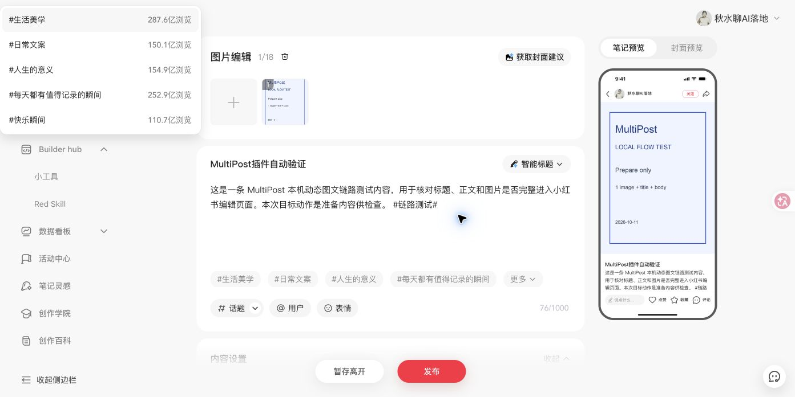

# 小红书动态图文：Agent 仅调用 CLI 的真实验收

> 路径迁移说明（2026-10-12）：Skill 现位于 `skills/qiushui-fast-publish/`，测试素材按场景存放于 `tests/fixtures/`，测试命令为 `python3 -m unittest discover -s tests -p 'test_*.py'`。下文的历史命令和旧路径保留执行时记录，文档链接已指向现位置。

日期：2026-10-11，当前电脑，目标动作 `prepare`。

## 运行职责

Agent 只调用本地脚本／HTTP；MultiPost 插件负责打开平台页、上传、填写和核对结果。浏览器控制工具只用于开发排错、一次性配对设置和回执完成后的观察，不是 Skill 的执行依赖。

Skill 位于 [skills/qiushui-fast-publish](../../skills/qiushui-fast-publish/SKILL.md)，安装与跨 Agent 使用方式见[setup.md](../../skills/qiushui-fast-publish/references/setup.md)。插件通过 Chrome alarms 约每 30 秒唤醒后台，带独立执行器凭证领取本机队列。任务认领与结果持久保存；中断不会自动重复投递。

## 实测步骤与证据

1. 用 `pnpm dev --no-cs-reload` 生成开发扩展，完成类型检查后停止热更新。
2. 重启本机服务，安装人员完成一次性配对，随后关闭配对页面和旧任务桥接页面。
3. CLI 查询 `connection` 得到 `paired: true / online: true`。
4. 执行 `python3 skills/multipost-publish/scripts/multipost.py run .multipost-local/agent-only-smoke --timeout 130`。
5. 从命令提交到回执完成，全程没有浏览器工具调用、页面点击或 Agent DOM 操作。扩展自行打开小红书并执行。
6. CLI 返回 `filled / FIELDS_VERIFIED` 后，再只读观察原标签页，实际标题、正文和图片与回执一致，保存截图。

任务 ID：`72ab75e1-194d-44a6-92c5-cd721a36ad29`；平台：`DYNAMIC_REDNOTE`；原标签页：`875191352`。创建时间戳 `1791694069.900181`，回执时间戳 `1791694095.416695`，总用时约 **25.5 秒**。

测试输入为标题“MultiPost插件自动验证”、测试正文、`链路测试` 标签文本及一张 900×1200 图片。账号沿用 Chrome `qiushui` 中已有的小红书会话“秋水聊AI落地”。

完整回执见[JSON](2026-10-11-rednote-agent-only-receipt.json)。

## 检查结果

- Python **12 项**测试通过；新增检查覆盖后台领取一次且不重复投递、执行器凭证与一次性配对校验、素材变化在交付前失败。
- TypeScript 类型检查、改动 TS 与 locale 的 Biome 检查、Skill 结构校验通过。
- 实际 Chrome 开发扩展完成配对，配对页关闭后仍自动领取任务；CLI 无浏览器控制参与取得终态回执。
- 原页面中断后的安全核查见[早期调试记录](2026-10-11-rednote-local-chain.md)。本轮没有退出账号或触发验证码；登录与验证码暂停分支仍未取得真实现场验收证据。

## 当前开放范围

仅开放小红书动态图文的 **已填写**。测试没有点击“暂存离开”或“发布”，不能报告“草稿已确认”或“发布已确认”。平台自身自动保存不属于本次验证结果。标签当前是正文文本；原生话题、原创声明、合集、草稿保存、直接发布和其他类型需继续适配及逐项验证。

移植到其他 Agent 后，运行需要同一电脑上的服务与已配对且运行中的浏览器扩展。Agent 只需要文件和命令／HTTP 能力；换电脑需重新配对并准备平台会话。
