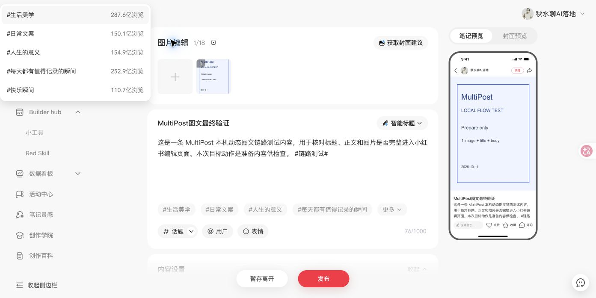

# 小红书动态图文：当前电脑完整链路验收

> 此文保留早期桥接页路径的调试证据。当前 Skill 已改为插件后台自动领取，Agent 不操作浏览器；最新验收见[仅 CLI 的完整链路](2026-10-11-rednote-agent-only.md)。

日期：2026-10-11（Asia/Shanghai）。本次目标动作是 `prepare`，验收范围为实际填写图文及可信结果回传。

## 实施内容

- 项目内 Skill：[multipost-publish](../../skills/multipost-publish/SKILL.md)，默认按类型读取 Skill 内的[平台配置](../../skills/multipost-publish/config/platforms.yaml)。当前仅开放 `DYNAMIC_REDNOTE` 的图文准备。
- [本机脚本](../../skills/multipost-publish/scripts/multipost.py)读取 `content.yaml`／`content.json`，检查正文、图片、平台子集和字段覆盖；本机 HTTP 桥接仅监听 `127.0.0.1:2663`。任务认领使用一次性凭证，素材先核对哈希，再转成任务内数据 URL。
- 扩展[本机任务服务](../../src/background/services/local-task.ts)校验精确调用来源、打开平台页面、等待加载并收集注入函数结果；回执在扩展本地存储和项目 `.multipost-local/tasks/` 中持久保存。
- [小红书准备适配](../../src/sync/dynamic/rednote-prepare.ts)沿用现有图文上传与填写流程，增加有界等待和真实字段核对。上传输入框的 files 不作为完成证据；检查实际编辑器中的图片预览、标题及正文。
- 中断后恢复同一任务，核查原标签页；已上传图片数量匹配且标题、正文均为空时只补填空字段。已有内容不匹配、原页关闭或图片丢失时报告结果不确定，避免重复上传或覆盖。

## 真实环境与结果

实际使用当前电脑的 Chrome `qiushui` 配置，已安装扩展 ID `jofhpmbhgfmhghkmofojmlohdogjdccd`，来源为本项目 `build/chrome-mv3-dev`。创作者页面显示已登录账号“秋水聊AI落地”。通过 `pnpm dev` 生成开发产物，没有运行生产构建。

完整路径为：本地内容目录 → Skill 脚本预检／提交 → Chrome 本机桥接页 → MultiPost 内容脚本 → 后台本机任务服务 → 小红书页面 → DOM 核对 → 本机持久回执 → Skill 脚本查询。

最终任务 `543fe33b-207b-4dd1-923a-d5317a33d7d6` 使用标题“MultiPost图文最终验证”、测试正文、一张 900×1200 测试卡及 `链路测试` 标签文本。回执与页面核对证据见[最终回执](2026-10-11-rednote-filled-receipt.json)和下图。

实际结果为 `filled / FIELDS_VERIFIED`：标题、完整正文和标签文本与本地输入一致，编辑器已显示一张对应测试卡。这个结果表示“已填写”；没有点击“暂存离开”或“发布”，未声明草稿保存或公开发布。

调试任务 `94965cec-d06d-4bae-a292-cdea826b47ae` 在第一次上传后遭遇开发热更新和页面重载，恢复时原页面已不能核对图文，正确保留为 `result_unconfirmed / RECONCILE_REQUIRED`，没有自动重新上传。第二个独立任务 `a9916d7e-234e-43f6-8118-8f8d9d3c9034` 已取得成功填写回执；最终任务在代码收尾并停止热更新后再次验证。平台自身可能自动保存编辑内容，测试记录不把草稿箱数量变化当作草稿保存回执。

## 检查记录

- Python 9 项测试通过：默认准备与字段覆盖、素材缺失、符号链接越界、未验证发布动作不降级、未配置平台、内容类型覆盖、伪图片、未实现字段、过期执行变为结果不确定。
- 本机 HTTP 实测拒绝重复认领、错误回传凭证与非本机网页来源；拒绝请求没有改变原任务回执。
- `pnpm exec tsc --noEmit` 通过；改动的 TypeScript 与 locale 文件通过 Biome；Skill 的 `quick_validate.py` 通过。
- 实际浏览器验证通过：插件握手、真实登录页面、真实图片上传与正文填写、逐任务回执写入和 CLI 查询。

## 已验证范围与后续

当前支持一个平台、一个类型、一个目标动作：小红书动态图文准备。标签是正文中的 `#标签#` 文本，原生话题选择尚未验证。暂存草稿、直接发布、原创声明、合集和其他内容类型尚未开放，收到这些动作或未适配字段时明确停止并说明原因。

登录暂停和验证码分支已有代码，但本轮使用的是现有已登录会话，没有退出账号或人为触发验证码来做真实验收。首次中断后的安全核查已真实验证；原页面保留完整图文时的继续补填分支尚未单独验证。

可调用：使用本项目 `skills/multipost-publish/SKILL.md`，准备一个符合规范的内容目录。Skill 负责读取配置、执行本机桥接和查询结果；示例内容位于 `skills/multipost-publish/assets/rednote-smoke/`。项目内 Skill 可按路径显式调用，未改动全局 Skill 安装。
